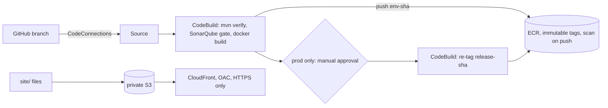

# AWS CI/CD Pipeline: CodePipeline, CodeBuild, SonarQube, ECR and CloudFront

A small, complete delivery pipeline on AWS, defined entirely in CloudFormation: a push to a branch is built and tested with Maven,
checked against a SonarQube quality gate, packaged as a Docker image and pushed to ECR. Production adds a manual approval and a
no-rebuild promote step. A second template serves a static site from a private S3 bucket through CloudFront.

| | |
|---|---|
| Built with | AWS CodePipeline, CodeBuild, ECR, S3, CloudFront, CloudFormation, IAM, Maven, JUnit 5, JaCoCo, SonarQube, Docker, GitHub Actions |
| App | a tiny Java 17 HTTP service (`/health`, `/greet`) with unit and HTTP tests; it exists only to give the pipeline something real to build |
| Environments | `dev`, `stage`, `prod`: one stack each, mapped to `develop`, `release`, `main` (see [docs/BRANCHING.md](docs/BRANCHING.md)) |
| Status | **written and statically checked; not yet deployed to a real AWS account** (details below) |

## How it flows

## What is in the repo
| Path | What it does |
|---|---|
| `app/` | Java app, Maven build with JaCoCo coverage, Dockerfile (non-root user) |
| `buildspec.yml`, `buildspec-promote.yml` | CodeBuild steps: test, quality gate, build and push; approved-image re-tag |
| `cloudformation/pipeline.yml` | ECR repo, artifact bucket, CodeBuild projects, CodePipeline, least-privilege IAM roles |
| `cloudformation/static-site.yml` | private S3 + CloudFront with origin access control, security headers, access logs |
| `sonarqube/docker-compose.yml` | local SonarQube Community for trying the gate |
| `.github/workflows/ci.yml` | runs the Maven tests, `cfn-lint` and `checkov` on every push and pull request |
| `scripts/deploy.sh`, `scripts/destroy.sh` | deploy one environment, and tear it down with a leftover check |

## Design choices
- **IAM is scoped, not broad.** CodeBuild can push only to its own ECR repository, write only to its artifact bucket and read only the one Sonar token secret.
- **Images are immutable and traceable.** Tags are `<env>-<commit>`; ECR scans on push; a lifecycle rule keeps the last 20.
- **Production is not rebuilt.** The approved image is re-tagged, so what was tested is what ships.
- **The static site bucket is never public.** Only the CloudFront distribution can read it, and plain HTTP is denied.
- **Secrets stay out of Git.** The SonarQube token lives in Secrets Manager and CodeBuild reads it at run time.

## What was and was not checked
Done in this repository:
- `cfn-lint` on both templates: passes.
- `checkov` on both templates: 53 passed, 0 failed, 5 skipped. Each skip is written next to the resource with its reason (no WAF on a static demo, default CloudFront certificate cannot enforce a TLS minimum, no access logs on short-lived artifacts or on the log bucket itself, no customer-managed KMS key for build logs).
- The Java code compiles, and the greeting logic and both HTTP endpoints were exercised by hand against a running instance.
- The shell scripts pass `bash -n` (syntax only).

**Not done yet:**
- The Maven/JUnit suite has not been run by me: the environment I built this in could not reach Maven Central. It runs in the GitHub Actions `test` job.
- Nothing has been deployed to AWS, so the pipeline, the SonarQube gate, the ECR push, the approval stage and the CloudFront site have not run for real.
- The branch-protection rules in `docs/BRANCHING.md` are a recommendation, not something this repo enforces.

## Run it on your own account
Cost is small but not zero: CodePipeline V2 bills per action-minute after the free allowance, CodeBuild bills per build minute, CloudFront and S3 cost cents for a demo, and ECR charges for stored images. Set a budget alarm first, and run `scripts/destroy.sh` when done.
1. In the AWS console create a GitHub connection (Developer Tools -> Settings -> Connections) and authorize it; copy its ARN.
2. Optional SonarQube: `docker compose -f sonarqube/docker-compose.yml up -d`, create a token, store it in Secrets Manager, and pass its URL and the secret ARN to the script. A SonarQube running on your laptop is not reachable from CodeBuild, so use a hosted or EC2-hosted server for a cloud run, or leave Sonar empty to skip the gate.
3. `scripts/deploy.sh dev <connection-arn>`; push to `develop`; watch the pipeline run.
4. `scripts/destroy.sh dev`.
